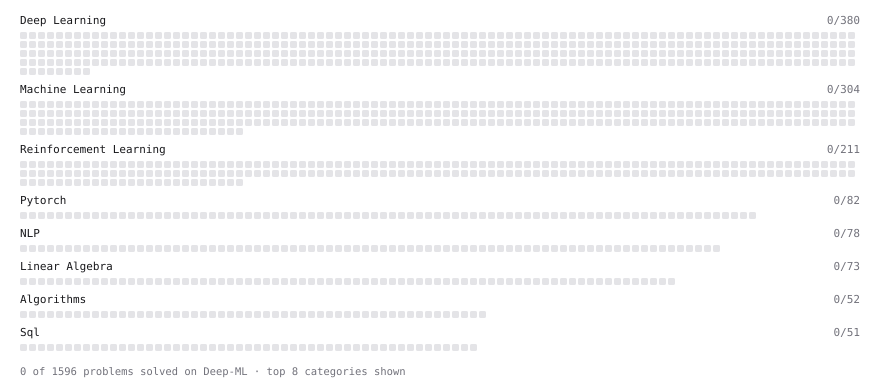

# Deep-ML

My machine learning practice from [Deep-ML](https://www.deep-ml.com). Every solution here was written by hand.

**4** solved · 0 problems · 0 labs · 4 math

[**Browse the interactive portfolio**](https://ningrunsen.github.io/deep-ml/) to replay this filling in over time.

## Math

| | Difficulty | Solved | |
| --- | --- | --- | --- |
| [Statistical Inference](https://www.deep-ml.com/math-problems/27) | medium | 2026-10-17 | [solution](math/0027-statistical-inference) |
| [The EM Algorithm](https://www.deep-ml.com/math-problems/41) | medium | 2026-10-17 | [solution](math/0041-the-em-algorithm) |
| [Bayesian Methods](https://www.deep-ml.com/math-problems/28) | hard | 2026-10-17 | [solution](math/0028-bayesian-methods) |
| [Probabilistic Models](https://www.deep-ml.com/math-problems/29) | hard | 2026-10-17 | [solution](math/0029-probabilistic-models) |

---

_This file is regenerated by Deep-ML on every push._
